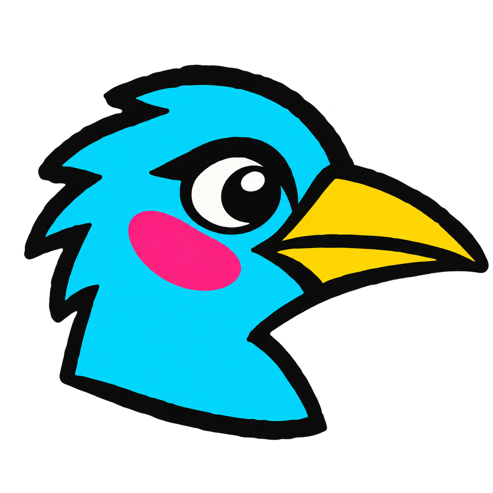

<div align="center">
  

  # Meet the Flock

  **Birds are not boring.**

  A colorful, neo-brutalist journey through all 11,064 living bird species.

  [](https://nextjs.org/)
  [](https://react.dev/)
  [](https://www.typescriptlang.org/)
  [](https://bun.sh/)
</div>

## About

Meet the Flock is a playful bird-discovery experience built around a loud neo-brutalist visual system: oversized typography, thick black borders, punchy colors, sticker illustrations, and unapologetic personality.

The site presents the complete living-species collection from the [Huashu Bird Sticker project](https://github.com/alchaincyf/huashu-bird-sticker), while keeping exploration quick through client-side search, order filters, and paginated results.

## Features

- Browse all **11,064 living bird species** from IOC World Bird List 15.2.
- Search by common name, scientific name, family, or order.
- Filter across all 44 taxonomic orders.
- Load only 48 sticker cards at a time for a responsive gallery.
- Open a dedicated, shareable `/birds/[slug]` profile for every species.
- Explore breeding range, habitat, migration, ecological niche, and measurements.
- Review IUCN and CITES conservation information.
- See names in English, Chinese, Japanese, Spanish, French, and German.
- Expand subspecies lists and move between neighboring species.
- Continue research through eBird, iNaturalist, GBIF, and Wikidata.
- Use the experience comfortably across desktop and mobile layouts.
- Respect reduced-motion preferences and semantic navigation.

## Routes

| Route | Purpose |
| --- | --- |
| `/` | Presentation-led landing page and introduction to the project. |
| `/birds` | Searchable, filterable gallery containing the complete collection. |
| `/birds/[slug]` | Detailed profile for an individual species. |

Example profile: `/birds/Bubo_bubo`

## Tech stack

- [Next.js 16](https://nextjs.org/) with the App Router, Cache Components, and Partial Prefetching
- [React 19](https://react.dev/)
- [TypeScript](https://www.typescriptlang.org/)
- [Tailwind CSS 4](https://tailwindcss.com/) with project-specific global CSS
- [Bun](https://bun.sh/) for package management and scripts

## Getting started

### Requirements

- Bun 1.3 or newer
- Node.js 20 or newer

### Installation

```bash
git clone https://github.com/nagraj05/flock.git
cd flock
bun install
```

### Development

```bash
bun run dev
```

Open [http://localhost:3000](http://localhost:3000).

### Production

```bash
bun run build
bun run start
```

### Quality checks

```bash
bun run lint
bunx tsc --noEmit
```

## Data architecture

The site deliberately separates lightweight gallery data from richer profile data:

| File | Use |
| --- | --- |
| `public/data/birds-index.json` | Compact search and gallery index loaded by the `/birds` client. |
| `public/data/birds.json` | Detailed species records used by the dynamic profile route. |
| `lib/birds.ts` | Server-side lookup, neighboring-species navigation, and label formatting. |
| `public/birds/` | Locally stored featured stickers used by the landing page. |

Gallery stickers are loaded from the upstream repository only when their current page is visible. This avoids bundling or downloading the complete sticker archive at once.

## Project structure

```text
app/
├── birds/
│   ├── [slug]/
│   │   ├── not-found.tsx
│   │   └── page.tsx
│   ├── birds-client.tsx
│   └── page.tsx
├── globals.css
├── icon.png
├── layout.tsx
└── page.tsx
lib/
└── birds.ts
public/
├── birds/
└── data/
```

## Visual language

The interface uses a compact palette shared across the landing page, gallery, and species profiles:

| Token | Color | Role |
| --- | --- | --- |
| Ink | `#111111` | Borders, typography, and hard shadows |
| Paper | `#F7F1E3` | Primary background |
| Yellow | `#F7EB33` | Calls to action and navigation |
| Orange | `#FF7448` | Feature sections and accents |
| Pink | `#FF75B5` | Filters and playful highlights |
| Cyan | `#50D7EC` | Range and informational sections |
| Blue | `#4B62F0` | High-contrast emphasis |
| Purple | `#B99AF8` | Bird-sticker stages |

## Credits and licensing

Bird stickers and species data come from [alchaincyf/huashu-bird-sticker](https://github.com/alchaincyf/huashu-bird-sticker), created by Huashu for the Mingji bird-watching app.

Please review the upstream licenses before reusing or deploying this project:

- Sticker artwork uses the **PolyForm Shield 1.0.0** license.
- The upstream license permits broad use but excludes competing birding, bird-identification, and field-guide applications, sites, or services.
- Structured data is provided under the **MIT License**.
- Some included fields and source references have additional attribution requirements documented by the upstream project.

This project treats the illustrations as a playful discovery gallery—not as identification plates. Always confirm fine field marks with a trusted field guide or biodiversity database.

---

<div align="center">
  <strong>Meet the flock. Pick a favorite. Change your mind immediately.</strong>
</div>
